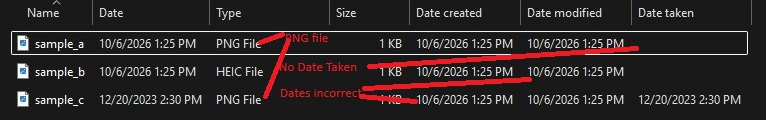
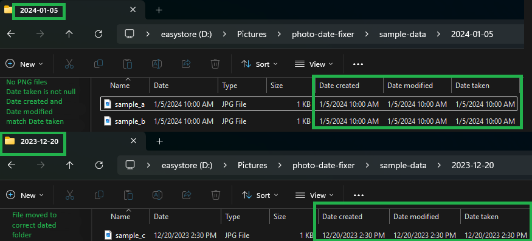

# media-date-organizer

**Fixes the dates on your photos and videos so they sort correctly in Windows.**

Photos copied from phones, cameras and apps often show a blank or wrong **Date Taken** in Windows Explorer. As a result, they sort by the day they were copied, not the day they were taken. media-date-organizer finds each file's real date, writes it in where it's missing, and files every photo and video in a folder named for that date. It runs as a [Claude Code](https://docs.anthropic.com/claude/docs/claude-code) plugin, so you can ask for things in plain English. It is also a standalone Python command-line tool.

| Before | After |
|---|---|
|  |  |

## Why it's useful

Missing dates are rarely just missing. They come from a handful of everyday problems, and this tool handles each one:

- **Extensions that lie.** A file named `.PNG` may really be an iPhone HEIC photo or a Live Photo video, and then the date reader fails. On the first real folder, 13 of 35 files were misnamed this way ([case study](docs/case-study.md)). The tool reads each file's first bytes to find its true format.
- **Formats Windows won't show.** Explorer never shows Date Taken for PNG, even when the date is inside the file, and BMP can't hold a date at all. The tool can convert both to JPEG with the right date.
- **Dates that only live in a name.** `IMG_20231220_142355.jpg` or a folder named `Aug 19 2026` holds the real date. The tool writes it into the file.
- **Clutter that isn't a photo at all.** App ads, half-copied files, Mac and iPhone sidecar files, and edit data saved as `.JPG`. These are set aside or reported, never silently deleted.

## What makes it different

- **Nothing changes until you say so.** Every step is a dry run by default: it lists what it *would* do and touches nothing. Add `--apply` to make the changes.
- **Nothing is lost by surprise.** Files are moved into review folders (`_ads`, `_junk`, `_incomplete`, `_empty_folders`) rather than deleted. Only one step deletes, cleaning up converted files, and it asks first. See [Guardrails](#guardrails).
- **A full audit trail.** Every run, previews included, is logged to an Excel workbook in the folder. You can see later what changed, when, and why.
- **Reads metadata itself.** It parses HEIC, MOV/MP4, JPEG, PNG and TIFF metadata directly, with no external tools needed just to read dates. ExifTool is only needed to write dates into HEIC and video files.
- **Plain English or command line.** In Claude Code you can type "Fill in the missing dates in D:\Pictures\2026". Every step is also a command-line flag you can script.
- **Tested on generated files.** 62 automated tests run against synthetic photos and videos, never real ones. They cover every step, the dry-run guarantee and the PowerShell cleanup script.

## Quick start

**You need:** Windows, Python 3.9+, and [Claude Code](https://docs.anthropic.com/claude/docs/claude-code) 2.1.275+ to use the plugin.

1. Install the plugin. In Claude Code:

   ```
   /plugin install media-date-organizer --marketplace Michele-Kummer/media-date-organizer
   ```

2. Install the Python packages:

   ```bash
   pip install "pillow>=10.0" "openpyxl>=3.1"
   ```

3. See what it would change. This changes nothing:

   ```
   /fix-media-dates D:\Pictures\2026
   ```

4. Happy with the preview? Make the changes:

   ```
   /fix-media-dates D:\Pictures\2026 --apply
   ```

Type these in the Claude Code chat (VS Code, the desktop app, or `claude` in a terminal), not in PowerShell itself. Not sure what to type? Run **`/media-help`**. First time? Try it on a copy of a small folder.

**Without Claude Code**, the same steps run from a clone:

```bash
git clone https://github.com/Michele-Kummer/media-date-organizer.git
cd media-date-organizer
pip install -r requirements.txt
python skills/media-date-organizer/scripts/organize.py --root "D:\Pictures\2026" --all           # preview
python skills/media-date-organizer/scripts/organize.py --root "D:\Pictures\2026" --all --apply   # make the changes
```

## What you can ask for

Lines starting with `/` are slash commands. The others are plain requests: any wording works, and Claude picks the right skill. Every step that changes files is previewed first.

| I want to… | Type |
|---|---|
| Step by step: see what each step would change, and choose the optional ones (changes nothing) | `/fix-media-dates D:\Pictures\2026` |
| Then make the changes you chose | `/fix-media-dates D:\Pictures\2026 --apply` |
| All in one go: see what the routine steps would change, with no questions (changes nothing; add `--quarantine-ads` or `--flatten` to include those) | `/fix-media-dates D:\Pictures\2026 --all` |
| Then make all of those changes | `/fix-media-dates D:\Pictures\2026 --all --apply` |
| See what moving everything up out of its subfolders would do (changes nothing) | `/flatten-media D:\Pictures\2026` |
| Then move them | `/flatten-media D:\Pictures\2026 --apply` |
| Find photos or videos that are copies of each other | `Find duplicates in D:\Pictures\2012` |
| See photos filed among videos, or videos among photos | `/report-opposite-type D:\Videos` |
| Find plist or XMP files saved with a photo name (changes nothing) | `Check D:\Pictures\2023 for plist files` |
| See what is left over after organizing | `Run the final check on D:\Videos` |
| Fill in only the missing dates | `Fill in the missing dates in D:\Pictures\2026` |
| Convert PNG screenshots to JPEG so Explorer shows their date | `Convert the PNGs in D:\Pictures\2026 to JPEG` |
| Convert BMP pictures to dated JPEGs | `Convert the BMPs in D:\Pictures\2026 to JPEG` |
| Fix extensions that don't match the file | `Fix the extensions in D:\Pictures\2026` |
| Set aside ad and app junk images | `Quarantine the ads in D:\Pictures\2026` |
| Set aside `.AAE`, `Thumbs.db` and Mac `._` files | `Move the junk files in D:\Pictures\2026` |
| Make Date Created and Date Modified match Date Taken | `Sync the timestamps in D:\Pictures\2026` |
| Compare the pixels of possible copies | `Visually compare the duplicates in D:\Pictures\2026` |
| Clean up converted files (deletes PNGs and BMPs already turned into JPEGs) | `Clean up the converted files in D:\Pictures\2026` |

## Step by step or all in one go

`/fix-media-dates` runs two ways. Both preview first and change nothing until you add `--apply`. **Choose one of them for a folder.** They are two routes to the same result, not steps to run one after the other.

- **Step by step** (`/fix-media-dates <folder>`): Claude walks through every step, shows what each would do, and asks which optional steps you want, cleanup included. Use this the first time, or on a folder you don't know well.
- **All in one go** (`/fix-media-dates <folder> --all`): one command runs the routine steps back to back, with no questions, and ends with one summary. Use this once you trust what the routine steps do.

| Step | Step by step | All in one go (`--all`) |
|---|---|---|
| Fix extensions | Yes | Yes |
| Scan and write the audit workbook (report) | Yes | No (every run is still logged) |
| Set junk aside in `_junk` | Yes | Yes |
| Set incomplete files aside in `_incomplete` | Yes | Yes |
| Set ads aside in `_ads` | If you choose it | Only with `--quarantine-ads` |
| Find plist and XMP files (report) | Yes | No |
| Convert BMP to JPEG | If you choose it | No |
| Fill in missing dates | Yes | Yes |
| Convert PNG to JPEG | If you choose it | Yes |
| Move to date folders | Yes | Yes |
| Sync timestamps | If you choose it | Yes |
| Flatten | If you choose it | Only with `--flatten` |
| Clean up converted files | Always asks you | No; run it on its own afterwards |
| Deletes anything | Only cleanup, if you say yes | Never |

## Recommended order

Every step can also run on its own, as a plain request or a command-line flag. This is the order that works best, and the order the step-by-step route uses.

**1. Fix the dates.** Choose one route, preview it, then apply it:

| Route | Preview | Apply |
|---|---|---|
| Step by step | `/fix-media-dates D:\Pictures\2026` | `/fix-media-dates D:\Pictures\2026 --apply` |
| All in one go | `/fix-media-dates D:\Pictures\2026 --all` | `/fix-media-dates D:\Pictures\2026 --all --apply` |

These are the steps inside, in the order they run:

| # | Step | What it does | Flag |
|---|---|---|---|
| 1 | Fix extensions | Reads each file's first bytes and renames any whose extension doesn't match its real format (PNG, JPEG, HEIC, MOV/MP4, 3GP, M2TS, MPG, WMV, AVI, GIF, WEBP, TIFF, BMP). Runs first, because every later step goes by the extension. | `--fix-extensions` |
| 2 | Scan (report) | Reads every file's real date and writes the audit workbook. Changes nothing. | `--report-only` |
| 3 | Set junk aside | Moves iPhone `.AAE` edit files, `Thumbs.db` and macOS `._` sidecars into `_junk`. | `--move-junk` |
| 4 | Set incomplete files aside | Moves empty, null-filled and headerless files, the remains of failed copies, into `_incomplete`. | `--move-incomplete` |
| 5 | Set ads aside (optional) | Moves app and game ad images and videos into `_ads`. Runs before dates are filled, so ads are not dated and filed with real photos. | `--quarantine-ads` |
| 6 | Find plist and XMP files (report) | Lists iPhone edit data and XMP text saved under a photo name. Changes nothing. | `--find-plists` |
| 7 | Convert BMP to JPEG (optional) | BMP can't hold a date, so each BMP becomes a JPEG dated from its filename or folder. | `--convert-bmp` |
| 8 | Fill in missing dates | Writes Date Taken (Media Created for video) from a date in the filename, else from the folder name. File modified time is never trusted, because copying resets it. | `--fill-blanks` |
| 9 | Convert PNG to JPEG (optional) | A PNG can hold a Date Taken, but Explorer never shows it. This re-encodes PNG as JPEG at quality 95 so Explorer does. Runs after step 8, which writes the date into the PNG, so the JPEG carries it over and one date pass is enough. Pictures with transparency stay PNG. | `--convert-png` |
| 10 | Move to date folders | Moves each file whose date doesn't match its folder into a folder named for its real date. Leave it out if you are going to flatten. | `--apply-moves` |
| 11 | Sync timestamps (optional) | Sets Date Created, and Date Modified on unedited files, to the date taken. | `--sync-timestamps` |
| 12 | Flatten (optional) | Moves everything up out of its dated subfolders into the folder itself. The alternative to step 10. Also `/flatten-media`. | `--flatten` |

**2. Check and tidy.** Once the dates are fixed:

| # | Step | What it does | Type |
|---|---|---|---|
| 13 | Find duplicates (report) | Files that are byte-for-byte identical, and pairs that are likely the same picture saved twice. | `Find duplicates in D:\Pictures\2026` |
| 14 | Find the opposite type (report) | Photos filed among videos, or videos among photos, by year folder. | `/report-opposite-type D:\Pictures` |
| 15 | Visual compare (report) | Compares the pixels of each possible copy, including each PNG and BMP with its new JPEG, and gives a verdict with a confidence level. Run it before step 16, which removes one file of each of those pairs. | `--visual-compare` |
| 16 | Clean up converted files | Deletes each PNG and BMP already converted to JPEG, once it has checked they are the same picture, and moves empty folders into `_empty_folders`. The step-by-step route asks about it as its last step. | `Cleanup-Pictures.ps1` |
| 17 | Final check (report) | What is left in `_ads`, `_junk` and `_incomplete`, folders not flattened, name collisions and audit workbooks. | `Run the final check on D:\Pictures` |

Steps 2, 6, 13, 14, 15 and 17 only report. Run them whenever you like.

## Guardrails

These hold for every step, whichever way you run it:

- **Preview by default.** Every step that changes files only lists what it would do (`WOULD MOVE`, `WOULD WRITE`, ...) until you add `--apply` (`-Apply` for the PowerShell cleanup script). In Claude Code, Claude shows you the preview and asks before applying.
- **Moved aside, not deleted.** Ads go to `_ads`, junk to `_junk`, broken copies to `_incomplete` and empty folders to `_empty_folders`, each keeping its subfolder path. Every step skips these folders. Deleting them is your call, once you have looked through them.
- **One step deletes, and it checks first.** Only "Clean up converted files" deletes. It removes a PNG or BMP only when a JPEG of the same name sits beside it with the same picture size and pixels no more than 1% apart. A Live Photo video, a sidecar, or a HEIC next to a JPG is always kept.
- **Nothing is overwritten.** When a file's new name or new folder is already taken, it is reported as a `COLLISION` and stays where it is. `--flatten` gives it a `_<date taken>` suffix instead.
- **Nothing leaves the folder.** Files are only renamed or moved inside the folder you give.
- **Content is checked, not just names.** An ad needs an ad-style name *and* no camera make or model. A `._` file must carry the Mac sidecar signature. `Thumbs.db` is matched by whole name, so `west sucking thumb.jpg` is safe. Plist or XMP text saved as a `.JPG` is reported and left alone. A file whose format it can't identify is never renamed.
- **Real dates win.** A date already in the file is never replaced. Missing dates come from the filename, then the folder name, never from the file's modified time.
- **Originals are kept on conversion.** PNG and BMP originals stay until you choose to clean them up. Writing a date into a JPEG doesn't re-encode the picture.
- **Edits are respected.** Timestamp sync leaves Date Modified alone on photos that look edited.
- **Everything is logged.** Every run, previews included, is added to the audit workbook in the folder. Close it in Excel first, or the run can't be recorded.

The full reference, with every flag, rule and edge case, is in the skill guide: [skills/media-date-organizer/SKILL.md](skills/media-date-organizer/SKILL.md).

## How it's built

- **Python 3.9+** (`organize.py`, about 2,750 lines) does the metadata parsing, date logic, moves and audit workbook. It uses Pillow for images and openpyxl for Excel. It reads HEIC and QuickTime metadata by walking the file's internal structure itself.
- **PowerShell** cleans up converted files (`Cleanup-Pictures.ps1`), using .NET `System.Drawing` to compare pixels.
- **Claude Code plugin:** three skills and four slash commands. These turn plain-English requests into the right steps, with a preview and a confirmation before any change.
- **Tests:** `py -m unittest discover tests -v` runs 62 tests on generated photos and videos. Video tests need ffmpeg; the ones that write video dates also need ExifTool, and they are skipped when it is missing.

```
.
├── .claude-plugin/              Plugin manifest and marketplace entry
├── commands/                    Slash commands: fix-media-dates, flatten-media, report-opposite-type, media-help
├── skills/media-date-organizer/ Main skill: organize.py and the cleanup script
├── skills/final-check-report/   Skill: what is left after organizing
├── skills/find-duplicates/      Skill: identical and likely duplicate files
├── tests/                       Automated tests
├── docs/                        Case study, user stories and bugs, screenshots, example audit
├── sample-data/                 Generator for synthetic test photos
└── _review/                     Files set aside, not deleted: the retired Fix-Extensions.ps1
```

## Project documents

- **[User stories and bugs](docs/user-stories-and-bugs.md):** the project's requirements, written as 31 user stories in 7 epics, each with acceptance criteria and a status. Also every known bug, open and resolved, with severity, who found it and the commit that fixed it. It's a worked example of how the requirements were gathered and tracked.
- **[Case study](docs/case-study.md):** how the approach changed on the first real folder, when a "blank Date Taken" problem turned out to be files with the wrong extension.
- **[Example audit workbook](docs/example-audit.xlsx):** what the Excel audit trail looks like.
- **[Command cheatsheet](docs/project-cheatsheet.md):** every command, ready to copy.

## Working on the plugin

To try changes from a local clone without installing, start Claude Code with the plugin loaded for that session:

```bash
claude --plugin-dir .
```

To pick up a newer published version, run `/plugin marketplace update michele-kummer`. Managing plugins (`/plugin`) works only in Claude Code in a terminal, not in the VS Code extension; from PowerShell, `claude plugin list` shows what is installed.

## License

MIT. See [LICENSE](LICENSE).
