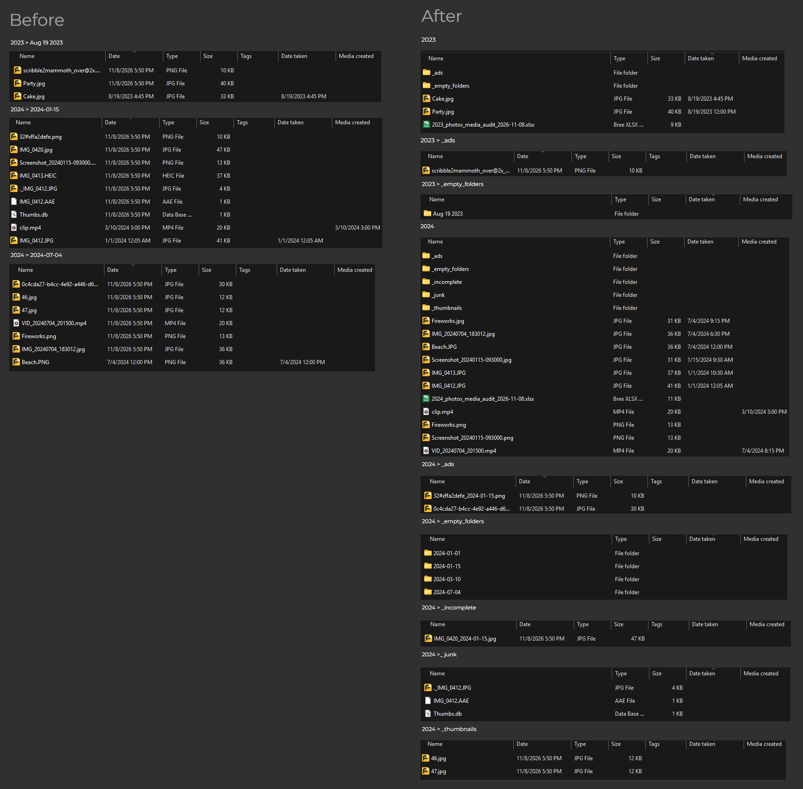

# media-date-organizer

**Fixes the dates on your photos and videos so they sort correctly in Windows.**

Photos copied from phones, cameras and apps often show a blank or wrong **Date Taken** in Windows Explorer. As a result, they sort by the day they were copied, not the day they were taken. media-date-organizer finds each file's real date, writes it in where it's missing, and files every photo and video in a folder named for that date. It runs as a [Claude Code](https://docs.anthropic.com/claude/docs/claude-code) plugin, so you can ask for things in plain English. It is also a standalone Python command-line tool.


The 2024 folder of the [sample data](sample-data/README.md), before and after the tool ran on it. Separately: [before](docs/screenshots/2024/Before_2024.jpg) and [after](docs/screenshots/2024/After_2024.jpg).

<details>
<summary>More detail: both years and every set-aside folder</summary>



Separately: [before](docs/screenshots/All/Before_All.jpg) and [after](docs/screenshots/All/After_All.jpg).

</details>

**How the work is tracked:** the requirements, user stories and bugs are on the [project board](https://github.com/users/Michele-Kummer/projects/1) and in [GitHub Issues](https://github.com/Michele-Kummer/media-date-organizer/issues), each with the date it was opened and closed.

## Why it's useful

Missing dates are rarely just missing. They come from a handful of everyday problems, and this tool handles each one:

- **Extensions that lie.** A file named `.PNG` may really be an iPhone HEIC photo or a Live Photo video, and then the date reader fails. On the first real folder, 13 of 35 files were misnamed this way ([case study](docs/case-study.md)). The tool reads each file's first bytes to find its true format.
- **Formats Windows won't show.** Explorer never shows Date Taken for PNG, even when the date is inside the file, BMP can't hold a date at all, and WebP pictures saved from web pages and messaging apps usually have none. The tool can convert all three to JPEG with the right date.
- **Dates that only live in a name.** `IMG_20231220_142355.jpg` or a folder named `Aug 19 2026` holds the real date. The tool writes it into the file.
- **Clutter that isn't a photo at all.** App ads, half-copied files, Mac and iPhone sidecar files, and edit data saved as `.JPG`. These are set aside or reported, never silently deleted.

## What makes it different

- **Nothing changes until you say so.** Every step is a dry run by default: it lists what it *would* do and touches nothing. Add `--apply` to make the changes.
- **Nothing is lost by surprise.** Files are moved into review folders (`_ads`, `_junk`, `_thumbnails`, `_screenshots`, `_incomplete`, `_converted`, `_empty_folders`) rather than deleted. No step deletes anything. See [Guardrails](#guardrails).
- **A full audit trail.** Every run, previews included, is logged to an Excel workbook in the folder. You can see later what changed, when, and why.
- **Reads metadata itself.** It parses HEIC, MOV/MP4, JPEG, PNG and TIFF metadata directly, with no external tools needed just to read dates. ExifTool is only needed to write dates into HEIC and video files.
- **Plain English or command line.** In Claude Code you can type "Fill in the missing dates in D:\Pictures\2026". Every step is also a command-line flag you can script.
- **Tested on generated files.** 166 automated tests run against synthetic photos and videos, never real ones. They cover every step, the dry-run guarantee and the PowerShell cleanup script.

## Quick start

**You need:** Windows, Python 3.9+, and [Claude Code](https://docs.anthropic.com/claude/docs/claude-code) 2.1.275+ to use the plugin.

1. Install the plugin. In Claude Code:

   ```
   /plugin install media-date-organizer --marketplace Michele-Kummer/media-date-organizer
   ```

2. Install the Python packages:

   ```bash
   pip install "pillow>=10.0" "openpyxl>=3.1"
   ```

3. See what it would change. This changes nothing:

   ```
   /fix-media-dates D:\Pictures\2026
   ```

4. Happy with the preview? Make the changes:

   ```
   /fix-media-dates D:\Pictures\2026 --apply
   ```

Type these in the Claude Code chat (VS Code, the desktop app, or `claude` in a terminal), not in PowerShell itself. Not sure what to type? Run **`/media-help`**. First time? Try it on a copy of a small folder.

**Without Claude Code**, the same steps run from a clone:

```bash
git clone https://github.com/Michele-Kummer/media-date-organizer.git
cd media-date-organizer
pip install -r requirements.txt
python skills/media-date-organizer/scripts/organize.py --root "D:\Pictures\2026" --all           # preview
python skills/media-date-organizer/scripts/organize.py --root "D:\Pictures\2026" --all --apply   # make the changes
```

## What you can ask for

Lines starting with `/` are slash commands. The others are plain requests: any wording works, and Claude picks the right skill. Every step that changes files is previewed first.

| I want to… | Type |
|---|---|
| Step by step: see what each step would change, and choose the optional ones (changes nothing) | `/fix-media-dates D:\Pictures\2026` |
| Then make the changes you chose | `/fix-media-dates D:\Pictures\2026 --apply` |
| All in one go: see what the routine steps would change, with no questions (changes nothing; add `--quarantine-ads`, `--sort-pictures`, `--apply-moves` or `--flatten` to include those) | `/fix-media-dates D:\Pictures\2026 --all` |
| Then make all of those changes | `/fix-media-dates D:\Pictures\2026 --all --apply` |
| See what moving everything up out of its subfolders would do (changes nothing) | `/flatten-media D:\Pictures\2026` |
| Then move them | `/flatten-media D:\Pictures\2026 --apply` |
| See which phone thumbnails would be set aside, once their dates are written (changes nothing) | `/move-thumbnails D:\Pictures\2026` |
| Then move them into `_thumbnails` | `/move-thumbnails D:\Pictures\2026 --apply` |
| See which screenshots and thumbnails (phone and backup) would be sorted into their own folders, once their dates are written (changes nothing) | `/sort-pictures D:\Pictures\2026` |
| Then move them into `_screenshots` and `_thumbnails` | `/sort-pictures D:\Pictures\2026 --apply` |
| Find photos or videos that are copies of each other | `Find duplicates in D:\Pictures\2012` |
| See photos filed among videos, or videos among photos | `/report-opposite-type D:\Videos` |
| Find photos and videos taken in a different year from their year folder (changes nothing) | `Find the files from another year in D:\Pictures\2020` |
| Find plist or XMP files saved with a photo name (changes nothing) | `Check D:\Pictures\2023 for plist files` |
| See what is left over after organizing | `Run the final check on D:\Videos` |
| Fill in only the missing dates | `Fill in the missing dates in D:\Pictures\2026` |
| Convert PNG screenshots to JPEG so Explorer shows their date | `Convert the PNGs in D:\Pictures\2026 to JPEG` |
| Convert BMP pictures to dated JPEGs | `Convert the BMPs in D:\Pictures\2026 to JPEG` |
| Convert WebP pictures (saved from web pages and apps) to dated JPEGs | `Convert the WebPs in D:\Pictures\2026 to JPEG` |
| Fix extensions that don't match the file | `Fix the extensions in D:\Pictures\2026` |
| Set aside ad and app junk images | `Quarantine the ads in D:\Pictures\2026` |
| Set aside `.AAE`, `Thumbs.db`, Mac `._` files, and plist and XMP files | `Move the junk files in D:\Pictures\2026` |
| Make Date Created and Date Modified match Date Taken | `Sync the timestamps in D:\Pictures\2026` |
| Compare the pixels of possible copies | `Visually compare the duplicates in D:\Pictures\2026` |
| Clean up converted files (moves PNGs, BMPs and WebPs already turned into JPEGs into `_converted`) | `Clean up the converted files in D:\Pictures\2026` |

## Step by step or all in one go

`/fix-media-dates` runs two ways. Both preview first and change nothing until you add `--apply`. **Choose one of them for a folder.** They are two routes to the same result, not steps to run one after the other.

- **Step by step** (`/fix-media-dates <folder>`): Claude walks through every step, shows what each would do, and asks which optional steps you want, cleanup included. Use this the first time, or on a folder you don't know well.
- **All in one go** (`/fix-media-dates <folder> --all`): one command runs the routine steps back to back, with no questions, and ends with one summary. Use this once you trust what the routine steps do.

| Step | Step by step | All in one go (`--all`) |
|---|---|---|
| Fix extensions | Yes | Yes |
| Audit dates and write the audit workbook (report) | Yes | No (every run is still logged; run `--audit` afterwards for an up-to-date report) |
| Set junk aside in `_junk` | Yes | Yes |
| Set incomplete files aside in `_incomplete` | Yes | Yes |
| Set ads aside in `_ads` | If you choose it | Only with `--quarantine-ads` |
| Find plist and XMP files (report) | Yes | No |
| Convert BMP to JPEG | If you choose it | No |
| Convert WebP to JPEG | If you choose it | No |
| Fill in missing dates | Yes | Yes |
| Convert PNG to JPEG | If you choose it | Yes |
| Move to date folders | If you choose it | Only with `--apply-moves` |
| Sync timestamps | If you choose it | Yes |
| Flatten | If you choose it | Only with `--flatten` |
| Set phone thumbnails aside in `_thumbnails` | No; run `/move-thumbnails` afterwards | Only with `--move-thumbnails` |
| Sort screenshots into `_screenshots` and thumbnails into `_thumbnails` | No; run `/sort-pictures` afterwards | Only with `--sort-pictures` |
| Clean up converted files | Always asks you | No; run it on its own afterwards |
| Deletes anything | Never | Never |

## Recommended order

Every step can also run on its own, as a plain request or a command-line flag. This is the order that works best, and the order the step-by-step route uses.

**1. Fix the dates.** Choose one route, preview it, then apply it:

| Route | Preview | Apply |
|---|---|---|
| Step by step | `/fix-media-dates D:\Pictures\2026` | `/fix-media-dates D:\Pictures\2026 --apply` |
| All in one go | `/fix-media-dates D:\Pictures\2026 --all` | `/fix-media-dates D:\Pictures\2026 --all --apply` |

These are the steps inside, in the order they run:

| # | Step | What it does | Flag |
|---|---|---|---|
| 1 | Fix extensions | Reads each file's first bytes and renames any whose extension doesn't match its real format (PNG, JPEG, HEIC, MOV/MP4, 3GP, M2TS, MPG, WMV, AVI, GIF, WEBP, TIFF, BMP). Runs first, because every later step goes by the extension. | `--fix-extensions` |
| 2 | Audit dates (report) | Reads every file's real date and writes the audit workbook. Changes nothing. | `--audit` |
| 3 | Set junk aside | Moves iPhone `.AAE` edit files, `Thumbs.db`, macOS `._` sidecars, and plist and XMP files (including ones saved under a photo name) into `_junk`. Phone gallery thumbnails stay put so step 8 can date them. | `--move-junk` |
| 4 | Set incomplete files aside | Moves empty, null-filled and headerless files, the remains of failed copies, into `_incomplete`. | `--move-incomplete` |
| 5 | Set ads aside (optional) | Moves app and game ad images and videos into `_ads`. When run on the folder that holds the year folders, each year gets its own `_ads`. Runs before dates are filled, so ads are not dated and filed with real photos. | `--quarantine-ads` |
| 6 | Find plist and XMP files (report) | Lists iPhone edit data and XMP text saved under a photo name. Changes nothing. | `--find-plists` |
| 7 | Convert BMP and WebP to JPEG (optional) | BMP can't hold a date, so each BMP becomes a JPEG dated from its filename or folder. WebP pictures, saved from web pages and messaging apps, usually have no date either: each becomes a JPEG that keeps the WebP's own date, or is dated the same way. Animated WebPs and ones with transparency stay WebP. Once the JPEG is checked to be the same picture, the WebP moves into `_converted`. | `--convert-bmp`, `--convert-webp` |
| 8 | Fill in missing dates | Writes Date Taken (Media Created for video) from a date in the filename, else from the folder name. File modified time is never trusted, because copying resets it. | `--fill-blanks` |
| 9 | Convert PNG to JPEG (optional) | A PNG can hold a Date Taken, but Explorer never shows it. This re-encodes PNG as JPEG at quality 95 so Explorer does. Runs after step 8, which writes the date into the PNG, so the JPEG carries it over and one date pass is enough. Pictures with transparency stay PNG. | `--convert-png` |
| 10 | Move to date folders (optional) | Moves each file whose date doesn't match its folder into a folder named for its real date. Leave it out if you are going to flatten. | `--apply-moves` |
| 11 | Sync timestamps (optional) | Sets Date Created, and Date Modified on unedited files, to the date taken. | `--sync-timestamps` |
| 12 | Flatten (optional) | Moves everything up out of its dated subfolders, and out of scratch folders such as `Temp`, `Junk`, `To Delete`, `Weird`, `To Review`, `New folder`, `DCIM`, `Camera Roll`, `Unsorted`, `Misc`, `Downloads` and `Import`, at any depth, into the folder itself. Named folders (a child, a trip, a wedding) are left as they are. The alternative to step 10. Also `/flatten-media`. | `--flatten` |

**Then, optionally, set phone thumbnails aside.** `/move-thumbnails D:\Pictures\2026` (flag `--move-thumbnails`) moves phone gallery thumbnails (a JPEG named only by a number of up to 10 digits, such as `1234.jpg` or `1000000714.jpg`, small, with no camera make or model) into `_thumbnails`. Run it after the dates are written: a thumbnail with no Date Taken yet is left where it is and listed, because once it is in `_thumbnails` no step dates it. Some thumbnails are the only copy left of a photo, so compare them with your photos before deleting any. Added to `--all`, it runs after the dates are written and before moving and flattening.

**Or sort screenshots and thumbnails into groups.** `/sort-pictures D:\Pictures\2026` (flag `--sort-pictures`) moves screenshots into `_screenshots` and thumbnails into `_thumbnails`, so each group can be looked through apart from the photos. A screenshot is a PNG, JPEG or HEIC with no camera make or model, named as phones and computers name screenshots (`Screenshot_20231220-142355.png`, `Screenshot (12).png`, `Screen Shot 2023-12-20 at 2.23.55 PM.png`) or carrying the "Screenshot" tag an iPhone writes inside the file. Thumbnails are phone gallery thumbnails as above, backup thumbnails (a small picture with no camera make or model named `IMG_1234_thumb.jpg`, `thumb_IMG_1234.jpg` or `tn_IMG_1234.jpg`, or kept in a `.thumbnails` or `Thumbs` folder), and the thumbnail cache files from iPhone backups (`.ithmb`) and Android (`.thumbdata`). As with `/move-thumbnails`, a picture with no Date Taken yet is left where it is. `--move-screenshots` sorts the screenshots on their own.

**2. Check and tidy.** Once the dates are fixed:

| # | Step | What it does | Type |
|---|---|---|---|
| 13 | Find duplicates (report) | Files that are byte-for-byte identical, and pairs that are likely the same picture saved twice. | `Find duplicates in D:\Pictures\2026` |
| 14 | Find the opposite type (report) | Photos filed among videos, or videos among photos, by year folder. | `/report-opposite-type D:\Pictures` |
| 15 | Find files from another year (report) | Photos and videos whose Date Taken (Media Created for a video) is in a different year from the year folder they are filed in, with a count for each year and how many have no date. Give one year folder or the folder that holds them. `Cleanup-Pictures.ps1` also runs it at the end. | `--other-year` |
| 16 | Visual compare (report) | Compares the pixels of each possible copy, including each PNG and BMP with its new JPEG, and gives a verdict with a confidence level. Run it before step 17, which removes one file of each of those pairs. | `--visual-compare` |
| 17 | Clean up converted files | Moves each PNG, BMP and WebP already converted to JPEG into `_converted`, once it has checked they are the same picture, and moves empty folders into `_empty_folders`. The step-by-step route asks about it as its last step. | `Cleanup-Pictures.ps1` |
| 18 | Final check (report) | What is left in `_ads`, `_junk`, `_thumbnails`, `_screenshots`, `_converted` and `_incomplete`, folders not flattened, name collisions and audit workbooks. | `Run the final check on D:\Pictures` |

Steps 2, 6, 13, 14, 15, 16 and 18 only report. Run them whenever you like.

## Why each step is needed

Each step fixes a problem that something else caused: a phone, a cloud service, a messaging app or a copy that went wrong. Knowing the cause helps you decide which optional steps your folder needs.

| Step | Why run it | Where the problem comes from |
|---|---|---|
| Fix extensions | A file whose extension lies can't be read or dated. Every later step goes by the extension, so a HEIC photo named `.PNG` fails each of them. | Share sheets, email, messaging apps and some transfer tools change a file's format but keep its old name. An iPhone Live Photo's video can arrive named as a picture. In the [case study](docs/case-study.md), 13 of 35 files were misnamed. |
| Audit dates (report) | Shows how many files have no date, or sit in the wrong folder, before anything changes. | Nothing is wrong yet. It is a baseline to compare against. |
| Set junk aside | Junk files look like pictures in a folder but hold none, and they make the other steps report errors. | An iPhone writes an `.AAE` file for every photo edited on it. Windows Explorer leaves `Thumbs.db` in folders it has shown as thumbnails. A Mac writes a `._` file beside everything it copies to a USB drive or memory card. Lightroom and other editors write `.xmp` files. Some of these arrive under a photo's name (`IMG_E5239.JPG`). |
| Set incomplete files aside | A broken file can never get a date and can't be opened. It is clutter, and a sign that the original still needs copying. | A copy that stopped part way: the phone was unplugged, the drive was full, or a transfer from a phone over USB (MTP) failed and left a tiny stub under the photo's name. |
| Set ads aside | Ads, stickers and app images get dated and filed among real photos, and they bury them. | Games and apps save their images to the phone's gallery, and a full phone backup or a copy of the whole storage brings them along. |
| Find plist and XMP files (report) | Lists files that look like photos but are really edit data, so you know what the junk step will move. | Same as junk: an iPhone or Mac edit file saved under a picture name. |
| Convert BMP and WebP | Neither shows a Date Taken in Explorer. BMP can't hold one at all, and WebP usually has none. | BMP comes from old scanners, Paint and old games. WebP is what browsers save from web pages, and what WhatsApp and other messaging apps use for stickers and shared pictures. |
| Fill in missing dates | A photo with no Date Taken sorts by the day it was copied, not the day it was taken. | Messaging apps (WhatsApp, Messenger), social media downloads and many editing apps remove the date when they save or send a picture. Screenshots, scans and downloads never had one. |
| Convert PNG to JPEG | Explorer never shows Date Taken for a PNG, even when the date is inside the file. | Phones and computers save screenshots as PNG, and Windows only reads Date Taken from JPEG, HEIC, TIFF and RAW. |
| Move to date folders | Files sit in folders named for the wrong day. | Import tools (Windows Photos, phone companion apps) name folders after the day you copied the files, not the day they were taken. |
| Sync timestamps | Other apps and cloud services sort by Date Created or Date Modified, which show the copy date. | Copying a file sets Date Created to the moment of the copy. Converting a file makes a new one, created today. |
| Flatten | Photos are spread across dozens of day folders and `Temp` folders, so you can't browse a year at a glance. | Import tools make a folder per day, and quick sorting leaves folders such as `Temp`, `To Sort` and `New folder` behind. |
| Set phone thumbnails aside | Thousands of small copies of your photos sit among the originals and look like duplicates. | A phone's gallery keeps a small preview of every photo in a hidden folder (`DCIM/.thumbnails`). Copying the whole phone, or a full backup, brings them along, named only by a number (`1234.jpg`). |
| Sort screenshots and backup thumbnails | Screenshots and small backup copies are mixed in with the photos, which makes the photos hard to browse. | Phones save screenshots to the camera roll alongside photos. Cloud backups (Google Photos, iCloud, OneDrive) and gallery apps download or keep a smaller copy of each photo, known as a thumbnail, beside or instead of the original, often named `IMG_1234_thumb.jpg` or kept in a `Thumbnails` folder. When storage-saving settings are on, the cloud sends the thumbnail and keeps the full picture online. iTunes and Finder backups of an iPhone or iPod keep thumbnails in `.ithmb` files, and Android keeps them in `.thumbdata` files. |
| Find duplicates (report) | The same picture saved twice wastes space and clutters albums. | Importing the same phone twice, restoring a backup over a folder that already had the photos, and sharing apps that save a re-sized copy. |
| Find the opposite type (report) | Videos in the photo library, or photos in the video library, are missed when you browse either one. | Import tools put everything from a phone in one folder, and a Live Photo comes with a short video beside the picture. |
| Find files from another year (report) | A photo filed under the wrong year is hard to find. | It was filed by the date it was copied, or its date was filled in from the wrong folder. |
| Visual compare (report) | Tells you whether two files that share a name are really the same picture before one is set aside. | Conversions, re-saved copies and name clashes in the steps above. |
| Clean up converted files | After conversion, every PNG, BMP and WebP sits beside its JPEG twin. | The conversion steps keep the original until it has been checked against the JPEG. |
| Final check (report) | Shows what is still waiting for you in the set-aside folders, and anything a step had to leave. | The steps never delete anything, so something is always left for you to look over. |

## Running steps earlier or later

The order under [Recommended order](#recommended-order) is the one that gives the cleanest result in one pass, and `--all` always runs its steps in that order, whatever order you type the flags in. When you run steps one at a time, this is what happens if you change the order:

| If you run… | …before or after… | What happens |
|---|---|---|
| Fix extensions | after anything else | The earlier steps skip or fail on misnamed files (`FAILED`, `NOT MEDIA`). Fix extensions, then run them again. |
| Set junk and incomplete files aside | after filling in dates | Fill in dates lists every plist saved under a photo name as `NOT MEDIA` and skips every broken file, so its report is noisy. Nothing is harmed. |
| Set ads aside | after filling in dates | Each ad gets its folder's date written into it, and looks like a dated photo in the audit. It is still found and moved afterwards, because the ad test goes by name and missing camera info, not by date. |
| Convert PNG to JPEG | before filling in dates | Each JPEG is made without a date. The next fill-in run dates the PNG and the JPEG separately, so the result is the same, but it takes two runs. |
| Sync timestamps | before converting | Each new JPEG shows today as Date Created. Run sync again after converting. |
| Move to date folders and Flatten | together | They undo each other: one files photos into day folders, the other empties them. Pick one. |
| Flatten | before filling in dates | Flatten only moves photos that have a Date Taken, so undated ones stay in their subfolders. Fill in dates, then flatten again. |
| Set thumbnails aside, or sort screenshots and thumbnails | before filling in dates | A thumbnail or screenshot with no date is left where it is and listed as `LEFT`, because once it is in `_thumbnails` or `_screenshots` no step dates it. Fill in dates, then run it again. |
| Set thumbnails aside, or sort screenshots and thumbnails | after flattening | They are flattened in among the photos first. They are still found and moved afterwards, but the year folder looks cluttered in between. |
| Sort screenshots | before cleanup | A screenshot PNG already converted to JPEG moves into `_screenshots` with its JPEG, and cleanup skips `_screenshots`, so the PNG stays beside its JPEG there. |
| Sort screenshots | after cleanup | Cleanup moves the converted PNG into `_converted` first, so only the JPEG goes into `_screenshots`. This is the tidier order. |
| Visual compare | after cleanup | The PNG and BMP originals are no longer beside their JPEGs, so those pairs can't be compared. Run it first if you want to check them. |
| Set ads aside | on a year folder, or on the folder that holds the year folders | On a year folder, the ads go into that year's `_ads`. On the folder above, each year's ads still go into its own `_ads`, and only stray ones go into the top `_ads`. |
| Final check | before the other steps | It works, but it reports what the other steps are about to fix. Run it last. |

## Limits

- **Windows only.** Setting Date Created, and checking what Explorer shows, only work on Windows.
- **No RAW camera files, and large video libraries are slow.** RAW files (`.CR2`, `.NEF`, `.ARW`) are not read or dated. More than a few thousand videos in one folder take a long time.
- **Writing HEIC and video dates needs ExifTool.** Without it, those files are listed as needing a date but not changed.
- **Some formats can't show a date in Explorer.** A PNG with transparent areas stays PNG, and an animated or transparent WebP stays WebP, so Explorer still shows no Date Taken for them.
- **A filled-in date is only as exact as its source.** A date taken from a folder name is set to 12:00 noon on that day. A video folder named only for a year (`2014`) is not used, and those videos are listed instead.
- **Video times use this computer's time zone.** Videos store their time in UTC, and it is converted to the time zone of the computer running the tool, so a video recorded while travelling may be a few hours off.
- **Ads are recognised by name.** An ad also needs no camera information, so an ad that carries some is kept. Numbered BMPs (`8824_1269.bmp`) are not treated as ads, because in real libraries they are as often the owner's own pictures.
- **Thumbnails are recognised by name, size and missing camera info.** A thumbnail larger than 1024 pixels is not caught. A small photo you resized yourself and named only by a number (`12.jpg`) could be taken for a phone thumbnail, so look through `_thumbnails` before deleting anything.
- **Screenshots are recognised by name or by the iPhone's tag.** A HEIC screenshot is only found by its name, because its tag can't be read without an extra library. The old Snipping Tool name `Capture.PNG` is not matched, because it is too general. A screenshot renamed to something else, with no tag, is not found.
- **Converting a PNG keeps its XMP only with Pillow 11 or later.** With an older Pillow, the iPhone's Screenshot tag is not carried into the JPEG.
- **Duplicates are only reported.** Nothing is moved or deleted by the duplicate and compare steps; deciding which copy to keep is yours.
- **The audit workbook must be closed.** If it is open in Excel, the run can't be recorded in it.
- **Known open bugs.** One unreadable file can stop a step part way (BUG-02). HEIF and AVIF photos are read as MP4 video, so fix extensions leaves them alone (BUG-04). Setting incomplete files aside is slow on large folders (BUG-36). See [User stories and bugs](docs/user-stories-and-bugs.md#part-2--bugs).

## Guardrails

These hold for every step, whichever way you run it:

- **Preview by default.** Every step that changes files only lists what it would do (`WOULD MOVE`, `WOULD WRITE`, ...) until you add `--apply` (`-Apply` for the PowerShell cleanup script). In Claude Code, Claude shows you the preview and asks before applying.
- **Moved aside, not deleted.** Ads go to `_ads`, junk to `_junk`, thumbnails to `_thumbnails`, screenshots to `_screenshots`, converted PNGs, BMPs and WebPs to `_converted` and broken copies to `_incomplete`, all flat (no subfolders). An ad or broken copy with no Date Taken gets its folder's date added to its name, so the date is not lost. Empty folders go to `_empty_folders`, keeping their path. Every step skips these folders. Deleting them is your call, once you have looked through them.
- **Converted originals are checked before they are set aside.** "Clean up converted files" moves a PNG, BMP or WebP into `_converted` only when a JPEG of the same name sits beside it with the same picture size and pixels no more than 1% apart. A Live Photo video, a sidecar, or a HEIC next to a JPG is always kept.
- **Nothing is overwritten.** When a file's new name or new folder is already taken, it is reported as a `COLLISION` and stays where it is. `--flatten` gives it a `_<date taken>` suffix instead.
- **Nothing leaves the folder.** Files are only renamed or moved inside the folder you give.
- **Content is checked, not just names.** An ad needs an ad-style name *and* no camera make or model. A `._` file must carry the Mac sidecar signature. `Thumbs.db` is matched by whole name, so `west sucking thumb.jpg` is safe. A phone thumbnail must be named only by a number, be small, and have no camera make or model. A backup thumbnail needs a thumbnail name or folder *and* must be small with no camera make or model, and `thumb` must be joined to the name by `_`, `-` or `.`. A screenshot needs a screenshot name or the iPhone's "Screenshot" tag *and* no camera make or model. Plist or XMP text saved as a `.JPG` is found by its content and moved into `_junk`, never deleted. A file whose format it can't identify is never renamed.
- **Real dates win.** A date already in the file is never replaced. Missing dates come from the filename, then the folder name, never from the file's modified time.
- **Originals are kept on conversion.** PNG and BMP originals stay until you choose to clean them up, which moves them into `_converted`. WebP originals move into `_converted` straight away, once the JPEG is checked to be the same picture. Writing a date into a JPEG doesn't re-encode the picture.
- **Edits are respected.** Timestamp sync leaves Date Modified alone on photos that look edited.
- **Everything is logged.** Every run, previews included, is added to the audit workbook in the folder. Close it in Excel first, or the run can't be recorded.

The full reference, with every flag, rule and edge case, is in the skill guide: [skills/media-date-organizer/SKILL.md](skills/media-date-organizer/SKILL.md).

## How it's built

- **Python 3.9+** (`organize.py`, about 3,500 lines) does the metadata parsing, date logic, moves and audit workbook. It uses Pillow for images and openpyxl for Excel. It reads HEIC and QuickTime metadata by walking the file's internal structure itself.
- **PowerShell** cleans up converted files (`Cleanup-Pictures.ps1`), using .NET `System.Drawing` to compare pixels, and the Windows Imaging Component to read WebP.
- **Claude Code plugin:** three skills and six slash commands. These turn plain-English requests into the right steps, with a preview and a confirmation before any change.
- **Tests:** `py -m unittest discover tests -v` runs 195 tests on generated photos and videos. Video tests need ffmpeg; the ones that write video dates also need ExifTool, and they are skipped when it is missing.

```
.
├── .claude-plugin/              Plugin manifest and marketplace entry
├── commands/                    Slash commands: fix-media-dates, flatten-media, move-thumbnails, sort-pictures, report-opposite-type, media-help
├── skills/media-date-organizer/ Main skill: organize.py and the cleanup script
├── skills/final-check-report/   Skill: what is left after organizing
├── skills/find-duplicates/      Skill: identical and likely duplicate files
├── scripts/                     Project scripts: import the user stories and bugs into GitHub Issues
├── tests/                       Automated tests
├── docs/                        Case study, user stories and bugs, screenshots, example audit
├── sample-data/                 Generator for a before and after sample folder
└── _review/                     Files set aside, not deleted: the retired Fix-Extensions.ps1
```

## Project documents

- **[User stories and bugs](docs/user-stories-and-bugs.md):** the project's requirements, written as 63 user stories in 8 epics, each with acceptance criteria and a status. Also every known bug, open and resolved, with severity, who found it and the commit that fixed it. It's a worked example of how the requirements were gathered and tracked. Since 2026-11-22 they are tracked in [GitHub Issues](https://github.com/Michele-Kummer/media-date-organizer/issues). `py scripts/import_github_issues.py` created each one there with the dates it really opened and closed (US-63). It previews first, and creates issues only with `--apply`. New ones use the **User story** and **Bug** forms in [.github/ISSUE_TEMPLATE](.github/ISSUE_TEMPLATE), which follow the same layout, and each bug has a `Found by` label. Stories have the **Feature** issue type and bugs the **Bug** type, and every issue is on the [project board](https://github.com/users/Michele-Kummer/projects/1) with its status, priority and severity.
- **[Case study](docs/case-study.md):** how the approach changed on the first real folder, when a "blank Date Taken" problem turned out to be files with the wrong extension.
- **[Example audit workbook](docs/example-audit.xlsx):** what the Excel audit trail looks like.
- **[Command cheatsheet](docs/project-cheatsheet.md):** every command, ready to copy.
- **[Desktop app prototype](docs/screenshots/Proto_Figma.jpg):** a Figma design of the planned desktop app (work in progress), from the stories in Epic 8.

## Working on the plugin

To try changes from a local clone without installing, start Claude Code with the plugin loaded for that session:

```bash
claude --plugin-dir .
```

To pick up a newer published version, run `/plugin marketplace update michele-kummer`. Managing plugins (`/plugin`) works only in Claude Code in a terminal, not in the VS Code extension; from PowerShell, `claude plugin list` shows what is installed.

## License

MIT. See [LICENSE](LICENSE).
